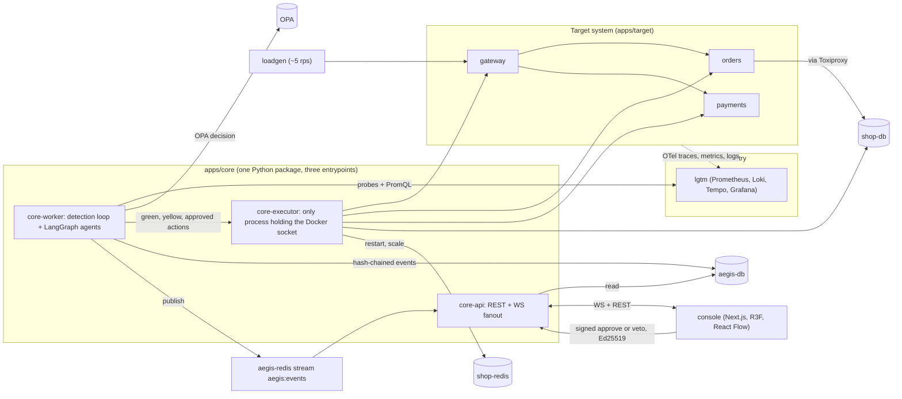

# AEGIS

Self-healing incident operations for a live three-service system: it detects injected faults, diagnoses them with LLM agents, fixes low-risk problems itself, routes risky fixes through a signed human approval, and keeps a hash-chained record of every decision.

[](https://github.com/Naresh23032003/AEGIS/actions/workflows/ci.yml)
<!-- TODO(license): add the license badge once LICENSE (Apache-2.0) is merged, task aegis-003 -->


<!-- TODO(demo): if the verification fix (aegis-001) lands, re-record with `make demo` and update the caption above from the real run. -->

Most self-healing demos sell the resolution. AEGIS sells the proof of resolution: a hash-chained event log, signed approvals, and a regulator-styled evidence pack for anything it touched.

## Why it exists

An agent that restarts production needs more than a green dashboard afterwards. AEGIS keeps the LLM out of detection and out of execution, gates every proposed action with a policy engine, and records each step so the heal can be replayed and its log re-verified.

## Features

- **Rules-based detection.** PromQL thresholds and health probes in [rules.yaml](apps/core/aegis/detection/rules.yaml), polled every 5 seconds, no LLM in the path.
- **LangGraph agent loop.** triage, diagnose, plan, act, verify, looping back to diagnose up to 3 times, with Postgres checkpoints so a killed worker resumes.
- **Closed action catalog.** Agents choose a `catalog_key` from [catalog.yaml](apps/core/aegis/actions/catalog.yaml); each key maps to one hardcoded Docker SDK or HTTP call. The executor never imports LLM code.
- **Policy gate on every action.** [OPA](packages/policies/aegis.rego) decides by tier: green executes, yellow opens a veto window, red blocks on an Ed25519-signed approval. A below-confidence proposal is denied and escalated.
- **Signed human decisions.** Approvals and vetoes are signed in the browser; the server verifies but holds no key that could forge one.
- **Hash-chained audit log.** `sha256(prev_hash || canonical_json(envelope))`, written in the same transaction as the row it describes. `GET /api/incidents/{id}/verify-chain` recomputes it.
- **Evidence pack.** `GET /api/incidents/{id}/evidence-pack` returns a zip of a PDF report and `events.jsonl`, with sections mapped to EU AI Act articles 12, 14 and 73. This is not a compliance claim.
- **Flight-recorder console.** Next.js with a React Three Fiber topology and a 2D React Flow fallback (`?view=2d`), fed by one WebSocket store.
- **Offline demo mode.** `MOCK_LLM=1` replays recorded fixtures, so the quickstart and CI need no API key.

## Architecture



The pipeline in one line:

```
detect  ->  triage  ->  diagnose  ->  plan  ->  policy gate  ->  execute  ->  verify
 rules       LLM         LLM          LLM         OPA            Docker       probes
```

A paragraph per layer is in [docs/architecture.md](docs/architecture.md); the eight decisions behind it are in [docs/adr/](docs/adr/).

## Tech stack

- Python 3.12: FastAPI, LangGraph, Pydantic v2 (generated from JSON Schema), PyNaCl, reportlab
- Node 22 or newer: Next.js, React Three Fiber, React Flow, Zustand
- Postgres, Redis (Streams), OPA/Rego, Toxiproxy, grafana lgtm (Prometheus, Loki, Tempo)
- Docker Compose; Groq for live LLM runs; Playwright for browser e2e and the demo recording
- Tooling: ruff, mypy (strict on apps/core), eslint, prettier, pytest, `opa test`

## Quick start

Docker and Python 3.12 are the only prerequisites. No API key: `MOCK_LLM=1` is the `.env.example` default.

```
git clone https://github.com/Naresh23032003/AEGIS.git
cd AEGIS
cp .env.example .env
make up
```

`make up` provisions its own `.venv` and npm workspace dependencies, builds the stack and starts every container. Time to healthy was 44.4s on a warm Docker build cache in the stranger test recorded in [FINAL_VERIFICATION.md](docs/reports/FINAL_VERIFICATION.md); a cold image build was not measured.

Open <http://localhost:3000>, go to **chaos**, and press **inject fault** on the **crash** card. The topology turns the stopped service red, an incident card appears when detection fires, and the heal follows. The **latency** card is the second act of the GIF: it does not heal, for the reason under [Known limitations](#known-limitations).

Tear down with `make down`.

## Configuration

All settings are environment variables, copied from `.env.example` into `.env`.

| Variable | Purpose |
|---|---|
| `MOCK_LLM` | `1` replays fixtures (default), `0` calls Groq |
| `GROQ_API_KEY` | Only needed when `MOCK_LLM=0` |
| `LLM_SMALL`, `LLM_LARGE` | Model names for light and heavy nodes |
| `SHOP_DATABASE_URL`, `AEGIS_DATABASE_URL` | Postgres for the shop and for the event log |
| `SHOP_REDIS_URL`, `AEGIS_REDIS_URL` | Shop cache, and the `aegis:events` stream |
| `OPA_URL` | Policy engine |
| `OTEL_EXPORTER_OTLP_ENDPOINT`, `PROMETHEUS_URL`, `LOKI_URL`, `TEMPO_URL` | Telemetry |
| `TOXIPROXY_URL` | Fault injection proxy |
| `NEXT_PUBLIC_API_URL`, `NEXT_PUBLIC_WS_URL`, `CONSOLE_ORIGIN` | Console endpoints |
| `PAYMENTS_URL` | Chaos endpoints reach payments directly |
| `EXECUTOR_URL`, `EXECUTOR_SHARED_SECRET` | Internal RPC to the executor; change the secret on anything but localhost |

## Measured results on gpt-oss-120b, gpt-oss-20b and qwen3.6-27b

Not the model running now. Three live runs per scenario against the real Groq API on that model set, pasted from [PHASE_6_REPORT.md](docs/reports/PHASE_6_REPORT.md):

| Scenario           | Autonomy | MTTR (avg) | Cost/incident | Action                     |
| ------------------ | -------- | ---------- | ------------- | -------------------------- |
| latency            | auto     | 92s        | $0.0025       | `remove_toxic` (green)     |
| crash              | auto     | 61s        | $0.0015       | `restart_service` (green)  |
| error_spike        | auto     | 132s       | $0.0030       | `rollback_config` (yellow) |
| memory_leak        | auto     | 21s        | $0.0019       | `restart_service` (green)  |
| cache_outage (n=1) | auto     | 136s       | $0.0023       | `remove_toxic` (green)     |

On the current model none of the five reproduces inside 20%, and `latency` does not heal at all. Read the table as a record of what that model set did. Fixture runs (`MOCK_LLM=1`, deterministic) heal four of the five in well under a minute each; that is the mode CI and the quick start use.

## Tests

```
make lint test      # ruff + mypy + eslint + prettier + pytest + tsc + opa test
make e2e            # scenario suite against a running stack (make up first)
make e2e-live       # same, with MOCK_LLM=0 and a Groq key in .env
```

CI ([ci.yml](.github/workflows/ci.yml)) runs lint, unit tests, brings the stack up on fixtures and runs `MOCK_LLM=1 make e2e`. Every OPA rule has an `opa test`; each chaos scenario has an e2e test.
<!-- TODO(demo): add the pass counts from a fresh `make lint test` run; none are quoted here because none were run for this draft. -->

## Known limitations

A production incident-response system this is not: one docker-compose host, five chaos scenarios, and a free-tier LLM key whose daily quota the project used up repeatedly.

**Diagnosis quality is the weak point.** The diagnose prompt once listed the five faults by mechanism, which let a model pattern-match without reading evidence. Both lists were removed in phases 12 and 13. Over five live diagnoses on `llama-3.3-70b-versatile` after that, one called `query_metrics` and `query_logs` before answering, four answered on turn 1 with no tool call, and none called `query_traces`. Across 29 live diagnoses and three phases the traces tool has never been called.

**`latency` does not heal.** Without the toxic's name in the prompt the model proposes `restart_service`, which does nothing to a Toxiproxy toxic. The incident closes anyway because verification never compares p95 to its threshold: in [rules.yaml](apps/core/aegis/detection/rules.yaml) the query is keyed `p95_latency` and the rule id is `latency_p95`, while `_probe_services_once` in [tools.py](apps/core/aegis/agents/tools.py) builds its threshold map by rule id and reads by query key. `test_latency_heals` fails because of it and is left in on purpose. Verification separately re-checks the injected fault, so these incidents carry `[injected fault still present at verify]` in the summary and the chained log. Detail in [FINAL_VERIFICATION.md](docs/reports/FINAL_VERIFICATION.md).
<!-- TODO(demo): if aegis-001 merges, replace the paragraph above with the real result of a fresh `make e2e` and `make demo`. -->

Kubernetes executor, Temporal, WebAuthn approvals and a larger catalog are not built here.

## Project structure

```
apps/
  console/      Next.js console (topology, chaos, metrics, flight recorder)
  core/aegis/   FastAPI api, worker and executor in one package
    actions/    closed catalog (catalog.yaml) and executor mapping (execute.py)
    agents/     LangGraph nodes, tools, quarantine wrapper
    detection/  rules.yaml, probes
  target/       gateway, orders, payments, loadgen: the system that gets broken
packages/
  contracts/    JSON Schema source of truth, generated Python and TS types
  policies/     OPA/Rego policy and its tests
deploy/         docker-compose.yml
e2e/            scenario suite (Playwright and HTTP)
scripts/        record_fixtures.py, record_demo.py, ensure-opa.sh
docs/           architecture.md, adr/, reports/, media/
plan/, PLAN.md  the specification the repo was built from
```

## Roadmap

The seven phases of [plan/06-milestones.md](plan/06-milestones.md) are built and each has a report in [docs/reports/](docs/reports/). Later phases fixed diagnosis prompts and verification and added the evidence pack and the demo recording. Open items:

- Fix the p95 threshold lookup in verification, then re-record the latency fixture with a live key.
- Kubernetes executor, Temporal migration, WebAuthn approvals, a larger catalog (see `docs/ROADMAP.md` once added, task aegis-005).
- Release `v0.1.0` with the MP4 attached (plan/07-review-and-launch.md).

## License

<!-- TODO(license): Apache-2.0, per plan/07-review-and-launch.md. State it here and link LICENSE once task aegis-003 merges; the repo has no LICENSE file today. -->

Built from the specification in [PLAN.md](PLAN.md), one phase at a time.
